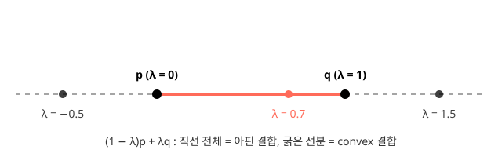

# 아핀 구조와 비선형성

신경망 교재는 $\mathbf{W}\mathbf{x} + \mathbf{b}$를 흔히 "선형층"이라 부른다. 이 장은 그 이름이 정확하지 않다는 데서 출발한다. 이 층은 선형이 아니라 **아핀**이고, 활성화 없이 아무리 쌓아도 하나의 아핀 사상을 벗어나지 못한다. 신경망이 복잡한 함수를 표현하게 만드는 것은 층의 수가 아니라 층 사이의 **비선형성**이다.

## 학습 목표

- 선형과 아핀의 차이를 설명한다
- 활성화 없이 쌓은 층의 합성이 하나의 아핀 사상임을 증명한다
- 비선형 활성화가 표현력을 바꾸는 방식을 설명한다

## 선형 변환과 아핀 변환

7.1장에서 본 선형사상 $f: \mathbb{R}^n \to \mathbb{R}^m$은 두 조건을 만족한다.

$$
f(\mathbf{x} + \mathbf{y}) = f(\mathbf{x}) + f(\mathbf{y}), \qquad f(\alpha\mathbf{x}) = \alpha f(\mathbf{x}).
$$

두 번째 조건에 $\alpha = 0$을 넣으면 $f(\mathbf{0}) = \mathbf{0}$, 즉 **선형사상은 원점을 원점으로 보낸다.** 행렬 곱 $\mathbf{x} \mapsto \mathbf{A}\mathbf{x}$가 바로 이런 사상이다.

::quiz{id="affine-is-not-linear"}

신경망의 한 층은 여기에 평행이동을 더한다.

$$
f(\mathbf{x}) = \mathbf{A}\mathbf{x} + \mathbf{b}.
$$

이런 사상을 **아핀 사상**(affine map)이라 한다. 원점의 상은 $f(\mathbf{0}) = \mathbf{b}$이므로, $\mathbf{b} \neq \mathbf{0}$이면 선형사상이 아니다. 선형성 조건이 얼마나 깨지는지도 계산할 수 있다.

$$
f(\mathbf{x} + \mathbf{y}) - f(\mathbf{x}) - f(\mathbf{y}) = (\mathbf{A}\mathbf{x} + \mathbf{A}\mathbf{y} + \mathbf{b}) - (\mathbf{A}\mathbf{x} + \mathbf{b}) - (\mathbf{A}\mathbf{y} + \mathbf{b}) = -\mathbf{b}.
$$

잔차가 정확히 $-\mathbf{b}$다. $\mathbf{b}$가 아무리 작아도 0이 아니면 선형성은 깨진다. 선형성은 근사의 문제가 아니라 정의의 문제다.

그렇다고 아핀 사상이 아무 함수나 되는 것은 아니다. 아핀 사상은 평면을 선형사상으로 변형한 뒤 **통째로 이동**시킬 뿐이어서, 직선을 직선으로, 평행선을 평행선으로 보내고, 한 직선 위 점들 사이의 길이 비율도 보존한다. 아래 위젯에서 bias를 켜고 끄며 격자와 원점의 상 $f(\mathbf{0})$이 어떻게 움직이는지 확인한다.

::widget{name="linear-map-2d" preset="shear"}

같은 계산을 코드로 확인한다.

```python {exec="browser" session="affine"}
import numpy as np

A = np.array([[1.0, 0.5],
              [0.0, 1.0]])
b = np.array([0.5, 0.25])

def f(x):
    return A @ x + b

x = np.array([1.0, 2.0])
y = np.array([-1.0, 0.5])
print("f(0)             =", f(np.zeros(2)))
print("f(x+y)-f(x)-f(y) =", f(x + y) - f(x) - f(y))
```

```output
f(0)             = [0.5  0.25]
f(x+y)-f(x)-f(y) = [-0.5  -0.25]
```

**동차좌표.** 아핀 사상은 원래 공간에서는 선형이 아니지만, 한 차원 높은 공간에서는 선형사상으로 쓸 수 있다. 벡터 끝에 1을 붙인 동차좌표(homogeneous coordinates) $\tilde{\mathbf{x}} = (\mathbf{x}, 1)$을 쓰면

$$
\begin{bmatrix} \mathbf{A} & \mathbf{b} \\ \mathbf{0}^\top & 1 \end{bmatrix}
\begin{bmatrix} \mathbf{x} \\ 1 \end{bmatrix}
=
\begin{bmatrix} \mathbf{A}\mathbf{x} + \mathbf{b} \\ 1 \end{bmatrix}
$$

이다. 구현에서 bias를 가중치 행렬에 흡수하는 기법, 컴퓨터 그래픽스에서 이동과 회전을 행렬 하나로 다루는 기법이 모두 이 아이디어다.

```python {exec="browser" session="affine"}
M = np.block([[A, b[:, None]],
              [np.zeros((1, 2)), np.ones((1, 1))]])   # (3, 3)
x_h = np.append(x, 1.0)                                # (3,)
print(M @ x_h)
print(f(x))
```

```output
[2.5  2.25 1.  ]
[2.5  2.25]
```

:::note[분야 예시]
일정한 외력을 받는 감쇠 진동자를 시간 간격 $\Delta t$로 이산화하면, 위치와 속도를 묶은 상태 $\mathbf{s}_k$의 업데이트가 $\mathbf{s}_{k+1} = \mathbf{A}\mathbf{s}_k + \mathbf{b}$ 꼴이 된다. 외력이 만드는 항 $\mathbf{b}$ 때문에 이 동역학은 선형이 아니라 아핀이다. 외력이 없으면 $\mathbf{b} = \mathbf{0}$이 되어 선형으로 돌아간다.
:::

데이터를 다룰 때도 아핀 사상은 어디에나 있다. 평균을 빼는 중심화 $\mathbf{x} - \boldsymbol{\mu}$, 단위를 바꾸는 환산(섭씨 → 화씨), 표준화 $(\mathbf{x} - \boldsymbol{\mu}) / \boldsymbol{\sigma}$는 모두 아핀 변환이다.

## 결합의 종류

점들을 계수로 섞는 방법은 계수에 거는 조건에 따라 세 가지로 나뉜다.

| 결합 | $\sum_i \lambda_i \mathbf{x}_i$의 조건 | 두 점 $\mathbf{p}, \mathbf{q}$로 만드는 집합 |
|---|---|---|
| 선형 결합 | 조건 없음 | 원점과 두 점이 만드는 평면(부분공간) |
| 아핀 결합 | $\sum_i \lambda_i = 1$ | $\mathbf{p}, \mathbf{q}$를 지나는 직선 |
| convex 결합 | $\sum_i \lambda_i = 1$, 모든 $\lambda_i \ge 0$ | $\mathbf{p}$와 $\mathbf{q}$ 사이의 선분 |

두 점의 아핀 결합은 $(1 - \lambda)\mathbf{p} + \lambda\mathbf{q}$ 꼴이다. $\lambda$가 0과 1 사이이면 선분 위의 점, 그 밖이면 선분을 벗어난 직선 위의 점이다.



::quiz{id="affine-combinations"}

아핀 사상은 아핀 결합을 보존한다. $\sum_i \lambda_i = 1$이면

$$
f\Big(\sum_i \lambda_i \mathbf{x}_i\Big) = \mathbf{A}\sum_i \lambda_i \mathbf{x}_i + \mathbf{b} = \sum_i \lambda_i \mathbf{A}\mathbf{x}_i + \sum_i \lambda_i \mathbf{b} = \sum_i \lambda_i f(\mathbf{x}_i)
$$

이다. 가운데 등호에서 $\mathbf{b} = \sum_i \lambda_i \mathbf{b}$를 쓰는 데 계수의 합이 1이라는 조건이 필요하다. 그래서 아핀 사상은 선분의 중점을 중점으로, 삼각형의 무게중심을 무게중심으로 보낸다.

이 구분은 연구에서 **보간과 외삽**의 구분으로 이어진다. 학습 데이터 점들의 convex 결합(convex hull) 안에 있는 입력은 이미 본 점들 "사이"에 있고, 그 밖의 입력은 본 적 없는 방향으로 나간 점이다. 과학 문제에서 새 조건·새 재료·더 긴 시간을 예측하는 일은 대부분 convex hull 밖으로 나가는 외삽이다.

## 선형층의 합성

활성화 함수 없이 두 층을 쌓으면 어떻게 될까. 전개하면

$$
g(\mathbf{x}) = \mathbf{W}_2(\mathbf{W}_1\mathbf{x} + \mathbf{b}_1) + \mathbf{b}_2 = (\mathbf{W}_2\mathbf{W}_1)\mathbf{x} + (\mathbf{W}_2\mathbf{b}_1 + \mathbf{b}_2)
$$

로, 가중치 $\mathbf{W} = \mathbf{W}_2\mathbf{W}_1$, bias $\mathbf{b} = \mathbf{W}_2\mathbf{b}_1 + \mathbf{b}_2$인 **하나의 아핀 사상**이다. $\mathbf{b}_1$에도 $\mathbf{W}_2$가 곱해진다는 점에 주의한다. 같은 논리를 반복하면(귀납법) $k$개의 층을 쌓아도 결과는 하나의 아핀 사상이다. 동차좌표로 보면 더 간단하다. 층마다 $(n+1) \times (n+1)$ 행렬 하나이고, 합성은 행렬 곱이다.

::quiz{id="stacked-affine-layers"}

```python {exec="browser" session="affine"}
rng = np.random.default_rng(0)
W1, b1 = rng.normal(size=(4, 2)), rng.normal(size=4)   # (4, 2), (4,)
W2, b2 = rng.normal(size=(3, 4)), rng.normal(size=3)   # (3, 4), (3,)

W, c = W2 @ W1, W2 @ b1 + b2                           # (3, 2), (3,)
x = rng.normal(size=2)
print(np.allclose(W2 @ (W1 @ x + b1) + b2, W @ x + c))
print("rank(W) =", np.linalg.matrix_rank(W))
```

```output
True
rank(W) = 2
```

깊이를 늘려도 표현할 수 있는 함수는 늘지 않는다. 오히려 줄어들 수 있다. 행렬 곱의 rank는

$$
\operatorname{rank}(\mathbf{W}_2\mathbf{W}_1) \le \min\big(\operatorname{rank}\mathbf{W}_1, \operatorname{rank}\mathbf{W}_2\big)
$$

를 만족하므로, 중간 층의 폭이 입력·출력보다 좁으면 그 폭이 병목이 된다. 예를 들어 $\mathbb{R}^{10} \to \mathbb{R}^{2} \to \mathbb{R}^{10}$으로 쌓으면 전체 사상의 rank는 2를 넘지 못한다.

:::note[분야 예시]
감쇠 진동자의 이산화된 업데이트 $\mathbf{s}_{k+1} = \mathbf{A}\mathbf{s}_k + \mathbf{b}$를 $k$번 반복하는 시뮬레이션(rollout)도 아핀 사상의 합성이다. 그래서 $\mathbf{s}_k$는 초기 상태 $\mathbf{s}_0$의 아핀 함수 $\mathbf{A}^k\mathbf{s}_0 + (\mathbf{A}^{k-1} + \cdots + \mathbf{I})\mathbf{b}$로 쓸 수 있다.
:::

이 결과는 실용적인 판단 기준이 된다. 입력과 출력의 관계가 거의 선형이라면 선형 모델(16.2장)이 깊은 신경망과 같은 성능을 더 적은 데이터로 낸다. 반대로 선형 모델이 크게 실패하는 문제라면, 활성화가 없는 깊은 모델도 똑같이 실패한다.

## 비선형성의 역할

층 사이에 비선형 함수를 넣으면 합성이 하나의 아핀 사상으로 접히지 않는다. 가장 널리 쓰이는 ReLU, $\mathrm{ReLU}(z) = \max(0, z)$로 무엇이 달라지는지 본다.

**1차원.** $f(x) = \mathrm{ReLU}(x) + \mathrm{ReLU}(x-1) + \mathrm{ReLU}(x-2)$를 생각한다. 각 ReLU는 자기 입력이 0이 되는 점에서 한 번 꺾인다. 그래서 $f$는 $x = 0, 1, 2$에서 꺾이고, 그 사이 구간에서는 아핀 함수다.

::quiz{id="relu-linear-regions"}

```python {exec="browser" session="affine"}
def relu(z):
    return np.maximum(0.0, z)

def g(x):
    return relu(x) + relu(x - 1) + relu(x - 2)

h = 1e-6
for x0 in [-1.0, 0.5, 1.5, 2.5]:
    print(f"x = {x0:4.1f}  기울기 = {(g(x0 + h) - g(x0)) / h:.3f}")
```

```output
x = -1.0  기울기 = 0.000
x =  0.5  기울기 = 1.000
x =  1.5  기울기 = 2.000
x =  2.5  기울기 = 3.000
```

네 구간의 기울기가 0, 1, 2, 3이다. 이런 함수를 **조각별 아핀**(piecewise affine) 함수라 한다.

**2차원 이상.** 첫 층의 뉴런 하나는 입력 공간에 초평면 하나($\mathbf{w}^\top\mathbf{x} + b = 0$)를 긋고, 그 양쪽에서 켜짐·꺼짐이 바뀐다. 뉴런들의 초평면이 공간을 여러 영역으로 나누고, 각 영역 안에서는 켜진 뉴런의 조합(활성 패턴)이 고정되므로 신경망 전체가 하나의 아핀 사상이 된다. 즉 **ReLU 신경망은 입력 공간을 조각내고 조각마다 다른 아핀 사상을 적용하는 함수**다. 평면 위의 직선 $n$개는 일반적인 위치에서 최대 $1 + n + n(n-1)/2$개의 영역을 만든다. 층을 더 쌓으면 앞 층이 만든 조각을 다시 접고 나누므로, 같은 뉴런 수로도 영역이 더 많아질 수 있다.

::widget{name="relu-regions"}

조각의 수는 표현력의 한 척도다. 조각이 많을수록 더 굽은 함수를 흉내 낼 수 있다. **보편 근사 정리**(universal approximation theorem)는 은닉층 하나로도 뉴런을 충분히 늘리면 유계 구간 위의 연속함수를 원하는 정확도로 근사할 수 있다고 말한다. 직관적으로는 조각을 잘게 쪼개 곡선을 꺾은선으로 따라가는 것이다.

이 정리가 말하지 않는 것도 분명히 해야 한다.

- 필요한 뉴런 수가 현실적인지 말하지 않는다.
- 경사하강으로 그런 파라미터를 **찾을 수 있는지** 말하지 않는다.
- 근사가 보장되는 범위는 정해진 유계 구간 안이다. 학습 데이터 밖에서 어떻게 행동할지(**외삽**)는 말하지 않는다.

ReLU 신경망은 가장 바깥 조각에서 아핀 함수이므로, 학습 구간을 벗어나면 직선으로 뻗어 나간다. 감쇠 진동자의 궤적 $x(t)$를 $t \in [0, 5]$에서 학습한 ReLU 신경망에게 $t = 10$을 물으면, 진동이 계속되는 대신 마지막 조각의 직선을 따라간 값을 내놓는다. 과학 문제에서 외삽이 흔하다는 점을 생각하면, 이것이 24장(과학 머신러닝)에서 물리 지식을 모델에 넣는 이유 중 하나다.

## 선형 근사로서의 미분

비선형 함수도 한 점 가까이에서는 아핀 함수처럼 보인다. 곡선을 계속 확대하면 결국 직선과 구별되지 않는다. 이를 식으로 쓴 것이 1차 Taylor 근사다.

$$
f(\mathbf{x}) \approx f(\mathbf{a}) + \mathbf{J}_f(\mathbf{a})(\mathbf{x} - \mathbf{a}).
$$

우변은 $\mathbf{x}$에 대한 아핀 함수이고, 기울기 행렬이 Jacobian $\mathbf{J}_f(\mathbf{a})$다. 미분은 "한 점 근처에서 가장 좋은 아핀 근사"를 찾는 일이라고 할 수 있다. 근사 오차는 $f$가 두 번 미분 가능하면 $\lVert \mathbf{x} - \mathbf{a} \rVert^2$에 비례해 줄어든다.

```python {exec="browser" session="affine"}
a = 0.5
def lin(x):
    return np.sin(a) + np.cos(a) * (x - a)    # x = a에서의 1차 근사

for d in [0.4, 0.2, 0.1, 0.05]:
    err = abs(np.sin(a + d) - lin(a + d))
    print(f"d = {d:4.2f}  오차 = {err:.2e}  오차/d^2 = {err / d**2:.4f}")
```

```output
d = 0.40  오차 = 4.71e-02  오차/d^2 = 0.2946
d = 0.20  오차 = 1.07e-02  오차/d^2 = 0.2681
d = 0.10  오차 = 2.54e-03  오차/d^2 = 0.2541
d = 0.05  오차 = 6.17e-04  오차/d^2 = 0.2470
```

거리 $d$를 절반으로 줄이면 오차는 약 4분의 1로 줄고, 오차를 $d^2$으로 나눈 값은 $\lvert \sin''(a) \rvert / 2 = \sin(0.5)/2 \approx 0.240$에 다가간다.

:::note[분야 예시]
진자의 운동 방정식 $\ddot{\theta} = -(g/\ell)\sin\theta$는 비선형이다. 작은 각에서 $\sin\theta \approx \theta$로 선형화하면 $\ddot{\theta} = -(g/\ell)\theta$, 즉 감쇠가 없는 진동자가 된다. 진폭이 커지면 이 근사는 깨진다. 선형화는 한 점 근처에서만 유효하다.
:::

이 관점은 뒤의 여러 장에서 다시 등장한다. 8.1장은 Jacobian을 일반적으로 다루고, 10장의 최적화는 손실을 국소적으로 1차·2차 함수로 근사해 내려갈 방향을 정하며, 8.4장의 역전파는 층마다의 Jacobian을 곱해 나간다.

## 실습

활성화 없는 MLP와 ReLU MLP가 2차원 평면을 어떻게 나누는지 시각화하고, 선형 영역의 수를 센다. 코드는 `labs/linear-algebra/affine-and-nonlinear/plane_warp.py`이고, 격자 위의 서로 다른 활성 패턴 수로 영역 수를 추정한다. 집필 시점의 실행 결과는 다음과 같다(난수 시드 0).

```output
활성화 없음, 은닉 [8, 8]    선형 영역    1개
ReLU, 은닉 [8]         선형 영역   34개
ReLU, 은닉 [8, 8]      선형 영역   65개
```

뉴런 8개짜리 한 층이 만든 34개는 직선 8개의 최대 영역 수 $1 + 8 + 28 = 37$보다 조금 적다. 일부 교점이 그림 범위($[-3, 3]^2$) 밖에 있기 때문이다. 두 층으로 쌓으면 같은 뉴런 수(층당 8개)로 영역이 65개로 늘어난다.

이어서 두 연습문제를 푼다. 테스트가 바로 채점한다.

::exercise{id="fold-affine-layers"}

::exercise{id="relu-breakpoints"}

## 실패 사례

- **bias가 있는 층을 '선형층'이라 부르며 선형성의 성질을 그대로 적용하는 것.** 예: 입력을 두 배로 하면 출력도 두 배가 된다고 가정하고 데이터 증강이나 정규화를 설계한다. 아핀 층에서는 $f(2\mathbf{x}) \neq 2f(\mathbf{x})$다.
- **깊이만 늘리면 표현력이 늘어난다고 생각하는 것.** 활성화를 빠뜨린 구현(예: 층을 리스트로 쌓고 활성화 호출을 잊음)은 깊이와 상관없이 선형 회귀와 같은 성능에 머문다. 깊은 모델이 선형 baseline과 똑같은 손실에서 멈추면 활성화가 빠졌는지부터 확인한다.
- **보편 근사 정리를 외삽 성능의 근거로 쓰는 것.** 정리는 정해진 구간 안의 근사만 말한다. 학습 범위 밖의 성능은 따로 검증해야 한다.

## 통과 기준

- $\mathbf{A}\mathbf{x}$와 $\mathbf{A}\mathbf{x} + \mathbf{b}$의 수학적 차이, 활성화 없는 층 합성의 결과, 비선형 활성화의 역할을 증명과 그림으로 설명한다.
- 연습문제 두 개(`fold-affine-layers`, `relu-breakpoints`)의 테스트를 통과한다.
